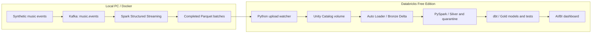

# PulseLake

**A music analytics lakehouse built with Kafka, Spark Structured Streaming,
Databricks, Delta Lake, dbt, and AI/BI dashboards.**

PulseLake simulates music activity, streams events through a local Kafka broker,
processes them into completed Parquet batches, and uploads them to Databricks.
A Lakeflow Job builds Bronze, Silver, and Gold tables for analytics.

## Architecture



Local ingestion runs continuously in microbatches. Cloud transformations run on
an hourly schedule or on demand using `AvailableNow`. This is streaming ingestion
with scheduled analytics; dashboard refresh is a separate step.

## What each tool does

| Tool | Responsibility |
|---|---|
| Docker Compose | Runs Kafka, the generator, and local Spark. |
| Kafka | Buffers events in `music.events`. |
| Spark Structured Streaming | Consumes Kafka with checkpoints; writes Parquet batches every 120 seconds by default. |
| Python / Databricks SDK | Uploads completed batches, verifies checksums, and records delivery receipts. |
| Databricks / Delta Lake | Stores and processes the Bronze and Silver layers. |
| dbt | Transforms Silver into Gold using SQL, incremental merges, and data tests. |
| Lakeflow Jobs | Executes setup -> Bronze -> Silver -> Gold in dependency order. |
| AI/BI dashboards | Presents listening metrics from Gold. |

## Implemented features

- Synthetic listening, page-view, and login events, including duplicate and invalid
  records to exercise data quality handling.
- Kafka ingestion with Spark checkpoints and recoverable Parquet batch publication.
- Automatic uploads with SHA-256 validation, a SQLite ledger, and retry reconciliation.
- Bronze ingestion with Auto Loader; Silver validation, deduplication, and quarantine.
- Four dbt models with data tests and incremental loading of listening facts.
- A serverless Databricks Job with sequential tasks and an hourly schedule.
- Dashboard datasets for listening totals, song rankings, daily activity, geography,
  subscriptions, and rejected records.

### Demonstrated results

The working demo was verified on November 17, 2026:

| Metric | Observed value |
|---|---:|
| Bronze events | 600 |
| Silver events | 567 |
| Gold listening events | 450 |
| Dashboard active listeners | 77 |
| Dashboard songs played | 5 |
| Dashboard listening hours | 26.73 |

The initial cloud dbt build completed four models and passed 18 data tests.
Successful four-task job runs, automatic uploads, and manual dashboard refresh
were verified. Automatic dashboard refresh after Gold remains an optional step
whose successful execution has not been confirmed.

These are historical demo results, not guaranteed results for every generated
batch. This renamed source release uses fresh `pulselake_*` resources. It has not
been redeployed to the existing live workspace. See [adopting the renamed version](docs/adoption.md).

## Requirements

- Python 3.11 and Git.
- Docker Desktop using Linux containers; the Spark image targets Linux AMD64.
- Databricks Free Edition or a workspace with Unity Catalog, serverless jobs, and
  a serverless/pro SQL warehouse.
- The [Databricks CLI](https://docs.databricks.com/aws/en/dev-tools/cli/install) on PATH.

The examples use PowerShell from the repository root. On macOS/Linux, use
`.venv/bin/python` in place of `.venv/Scripts/python.exe`.

## Setup

### 1. Install Python dependencies

Clone or download this repository into a folder named `pulselake`, then:

```powershell
cd D:\projects\pulselake
py -3.11 -m venv .venv
.\.venv\Scripts\python.exe -m pip install -r requirements.txt -r requirements-dbt.txt
```

A virtual environment must be created locally; it is not included in the repository.

### 2. Configure your workspace

Replace the example host and warehouse ID with your own values. Find the warehouse
ID under **SQL Warehouses > your warehouse > Connection details**.

```powershell
.\.venv\Scripts\python.exe scripts\configure.py --host https://YOUR-WORKSPACE.cloud.databricks.com --warehouse-id YOUR_WAREHOUSE_ID
databricks auth login --host https://YOUR-WORKSPACE.cloud.databricks.com --profile pulselake
```

The configuration command writes ignored `runtime/settings.json` and creates
ignored `dbt/profiles.yml` from the example. It does not request a password or token.
The CLI stores authentication using its normal credential mechanism. Local dbt may
open a separate OAuth browser login. Python runners load the local settings and
allow environment variables to override them. `.env` is only used by Docker Compose.

The default catalog is `workspace`. Use `--catalog YOUR_CATALOG` during configuration
if required. Replace `workspace` in dashboard SQL when using another catalog.

### 3. Initialize Databricks storage

Import these files together into one workspace folder as Python notebooks:

```text
databricks/_common.py
databricks/00_setup.py
databricks/01_bronze.py
databricks/02_silver.py
```

Run **00_setup** once with the same catalog selected above. This creates the
schemas, empty ingestion tables, audit table, and volume. For the default catalog,
the landing directory is:

```text
/Volumes/workspace/pulselake_bronze/ingest/landing
```

### 4. Build local services

Open Docker Desktop, wait for the engine, then run:

```powershell
docker compose config --quiet
docker compose up -d --build kafka kafka-init spark
docker compose --profile generate build producer
```

Kafka initialization should exit successfully; Kafka and Spark should remain
running. First startup downloads images and the matching Spark Kafka connector.

## Run an end-to-end test

### Terminal 1: automatic upload watcher

```powershell
.\.venv\Scripts\python.exe scripts\run_uploader.py --watch
```

Leave it open. It checks for completed local batches every 15 seconds.
`uploaded_files` counts new transfers; `reconciled_files` counts verified existing
remote files; `already_uploaded_files` counts files recorded in the delivery ledger.

### Terminal 2: generate events

```powershell
docker compose run --rm producer --count 200 --rate 5
```

Allow roughly 2-3 minutes for Spark to finish a batch; startup can take longer.
Confirm an upload before starting cloud processing. For continuous generation:

```powershell
docker compose run --rm producer --count 0 --rate 5
```

Stop continuous generation with Ctrl+C. Keep the PC awake and Docker and the
watcher running while sending new events.

### Deploy and run the cloud job

```powershell
.\.venv\Scripts\python.exe scripts\deploy_pipeline.py
```

This validates the bundle, uploads notebooks and dbt code, creates/updates the job,
and submits a run. In **Jobs & Pipelines > PulseLake Pipeline > Runs**, verify:

```text
setup -> bronze -> silver -> gold
```

The Gold task runs `dbt build`. Normal operation does not require manually running
individual notebooks or running dbt locally. Data arriving after a task collects
its input can be processed in the next run.

The schedule starts **paused** for the initial test. After success, change
`schedule.pause_status` to `UNPAUSED` in `databricks.yml`, then redeploy. The schedule
runs hourly in Asia/Calcutta. Bundle-managed jobs should be changed in source;
UI-only edits can be overwritten on redeployment.

For optional local dbt development, after Bronze and Silver contain data:

```powershell
.\.venv\Scripts\python.exe scripts\run_dbt.py
```

## Tables and dashboard

| Table in the configured catalog | Purpose |
|---|---|
| `pulselake_bronze.events` | Raw event payloads and Kafka/ingestion metadata. |
| `pulselake_silver.events` | Valid events, deduplicated by event ID. |
| `pulselake_silver.quarantine` | Invalid records and rejection reasons. |
| `pulselake_gold.fact_listens` | Listening facts, incrementally merged by event ID. |
| `pulselake_gold.dim_users` | User attributes from valid events. |
| `pulselake_gold.dim_songs` | Song attributes. |
| `pulselake_gold.daily_metrics` | Daily listening aggregates. |
| `pulselake_ops.pipeline_runs` | Notebook-stage audit history. |

Silver includes more than listening events, so its row count differs from Gold.
Active listeners count users who listened, not all users in the dimension table.
Song count can stay at five because the simulator reuses its catalog.

Follow [the dashboard guide](docs/dashboard.md) and use the six SELECT queries in
`databricks/dashboard/`. After the job succeeds, refresh the dashboard itself;
browser reload alone can show cached results. To refresh after Gold automatically,
publish the dashboard and add a Dashboard task depending on `gold`. See
[the pipeline guide](docs/pipeline.md). This fifth task is not in the default bundle.

## Verification

Run local tests without a Kafka broker or Databricks account:

```powershell
.\.venv\Scripts\python.exe -m unittest discover -s tests -v
```

After configuring the local dbt profile, parse models without executing SQL:

```powershell
.\.venv\Scripts\python.exe scripts\run_dbt.py --parse-only
```

Inspect local streaming output:

```powershell
docker compose ps -a
docker compose logs --tail 60 spark
.\.venv\Scripts\python.exe -m pulselake.inspect_batches
```

Compare cloud layers in the SQL Editor:

```sql
SELECT 'Bronze events' AS metric, COUNT(*) AS total
FROM workspace.pulselake_bronze.events
UNION ALL
SELECT 'Silver events', COUNT(*) FROM workspace.pulselake_silver.events
UNION ALL
SELECT 'Gold listens', COUNT(*) FROM workspace.pulselake_gold.fact_listens;
```

## Recovery and limitations

- Spark publishes only completed batches from staging to the ready directory.
- Persistent Kafka offsets, deterministic upload names, checksum validation, and
  the upload ledger make retries recoverable. Silver additionally deduplicates IDs.
- A repeated event ID keeps the first accepted event; it is not an update.
- Timestamps use UTC. Gold incremental selection uses ingestion time so older
  events arriving later can still be processed.
- There is no single atomic exactly-once transaction across Kafka, disk, the Files
  API, and Delta. Complete distributed failure/replay testing remains open.
- Keep checkpoints, Kafka volumes, and receipts together with their matching source.
  Do not reuse old checkpoints with an empty Kafka broker.
- Confirmed remote files are assumed immutable. Local uploaded batches are retained;
  automatic spool cleanup is not implemented. Kafka retention is seven days.
- One local broker and local-mode Spark are development infrastructure. Free Edition
  compute quotas apply. No production throughput/latency claim has been measured.

Stop the producer, allow pending batches/uploads to finish, stop the watcher, then:

```powershell
docker compose stop
```

Restart with `docker compose up -d kafka kafka-init spark`. Avoid `down -v` when
retaining data. See [troubleshooting](docs/pipeline.md) for common failures.

## Repository layout

```text
pulselake/                 Generator, producer, streaming, batches, uploader
databricks/               Setup, Bronze/Silver notebooks, dashboard SQL
dbt/                      Gold models, source declarations, and tests
docker/                   Container definitions
scripts/                  Configuration, deployment, upload, and dbt runners
tests/                    Local tests
docs/                     Dashboard, deployment, and adoption guides
compose.yaml              Local service configuration
databricks.yml            Cloud job bundle
```

`runtime/`, `.venv/`, `.tools/`, `.databricks/`, local profiles, `.env`, generated
PDFs, and build artifacts are ignored by Git. Public source contains no personal
workspace host, warehouse ID, or credential files. Review `git status` before
publishing; upload this repository's source, not a copy of your runtime directory.
