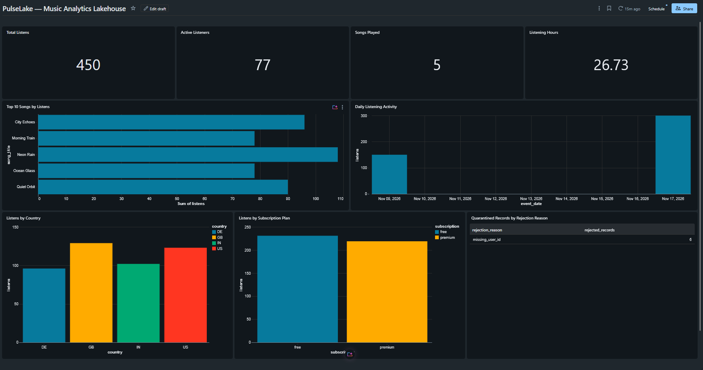
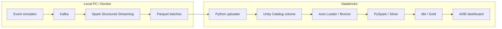
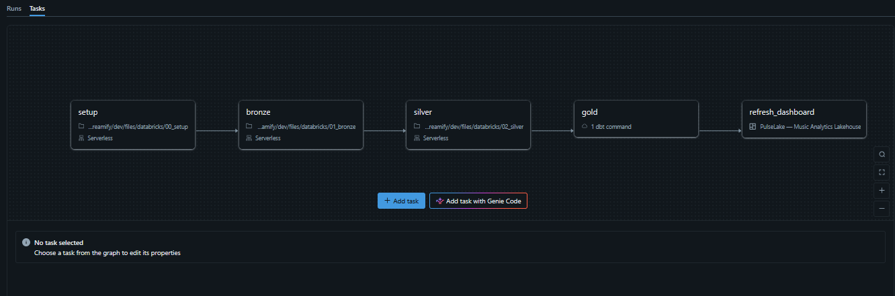
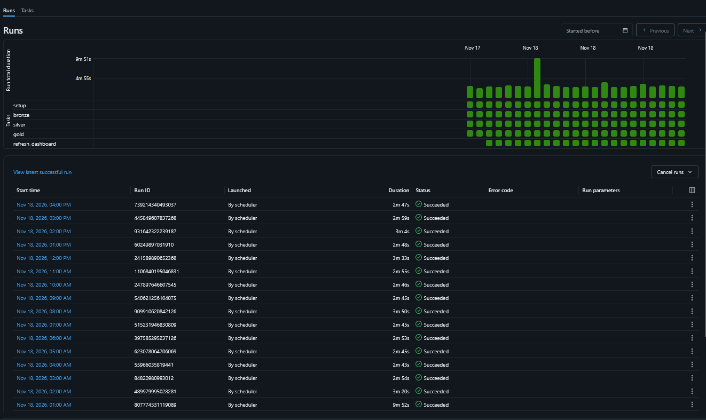

# PulseLake

A music analytics lakehouse built with **Kafka, Spark Structured Streaming,
Databricks, Delta Lake, and dbt**. PulseLake turns synthetic music events into
validated analytics tables and a dashboard refreshed by scheduled jobs.

## Dashboard



The demo processed **600 raw events into 567 valid events and 450 listening facts**.
The dashboard covers listening hours, active listeners, top songs, geography,
subscription plans, and quarantined records.

## Architecture



Spark processes events continuously in microbatches. Databricks transforms the
uploaded data hourly or on demand, then refreshes the published dashboard.

## Key features

- **Streaming ingestion:** Kafka and Spark with persistent checkpoints.
- **Reliable uploads:** completed Parquet batches, SHA-256 verification, delivery
  receipts, and retry reconciliation.
- **Data quality:** validation, event deduplication, and quarantine handling.
- **Analytics engineering:** four dbt models with incremental loading and 18 data tests.
- **Automation:** a five-task Databricks Job, including dashboard refresh after Gold.

| Layer | Purpose |
|---|---|
| Bronze | Preserve raw events and Kafka metadata. |
| Silver | Validate and deduplicate events; quarantine invalid records. |
| Gold | Build `fact_listens`, `dim_users`, `dim_songs`, and `daily_metrics`. |

## Pipeline in action

```text
setup -> bronze -> silver -> gold -> refresh_dashboard
```

<details>
<summary>View the Databricks task graph</summary>



</details>

<details>
<summary>View successful scheduled runs</summary>



</details>

The screenshots show the working demo, including successful scheduled dashboard
refreshes. The renamed source release has passed local checks; its cloud deployment
has not been retested. See [deployment notes](docs/adoption.md).

## Getting started

**Requirements:** Python 3.11, Docker Desktop with Linux containers (AMD64), the
Databricks CLI, and a Databricks workspace with Unity Catalog, serverless jobs,
and a serverless/pro SQL warehouse. The demo uses Databricks Free Edition.

From the repository root:

```powershell
py -3.11 -m venv .venv
.\.venv\Scripts\python.exe -m pip install -r requirements.txt -r requirements-dbt.txt
```

Follow the [setup guide](docs/getting-started.md) to configure your workspace,
start ingestion, publish the dashboard, and deploy the job. Connection settings
stay in ignored local files. The job schedule starts paused until the first test
succeeds.

## Tests

```powershell
.\.venv\Scripts\python.exe -m unittest discover -s tests -v
```

**24 local tests pass**, covering configuration, event generation, Parquet batches,
checksum validation, and upload recovery. The demonstrated cloud dbt build passed
**18 data tests**.

## Project structure

```text
pulselake/       Event generation, streaming, batch handling, and uploads
databricks/     Lakehouse notebooks and dashboard SQL
dbt/            Gold models and data tests
docker/         Container definitions
scripts/        Configuration, deployment, and execution helpers
tests/          Local tests
docs/           Setup guides and screenshots
```

## Documentation

- [Setup and first run](docs/getting-started.md)
- [Pipeline deployment and troubleshooting](docs/pipeline.md)
- [Dashboard setup](docs/dashboard.md)
- [Operations and recovery](docs/operations.md)

This is a development project using synthetic data, local streaming, and scheduled
cloud analytics. Free Edition quotas apply; throughput and end-to-end latency have
not been benchmarked.
